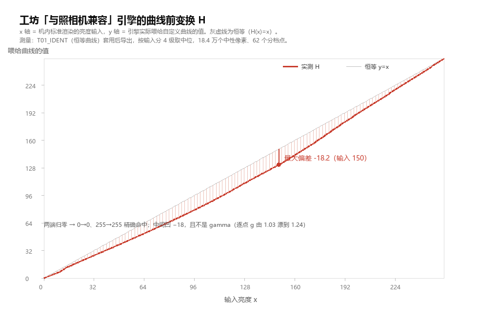
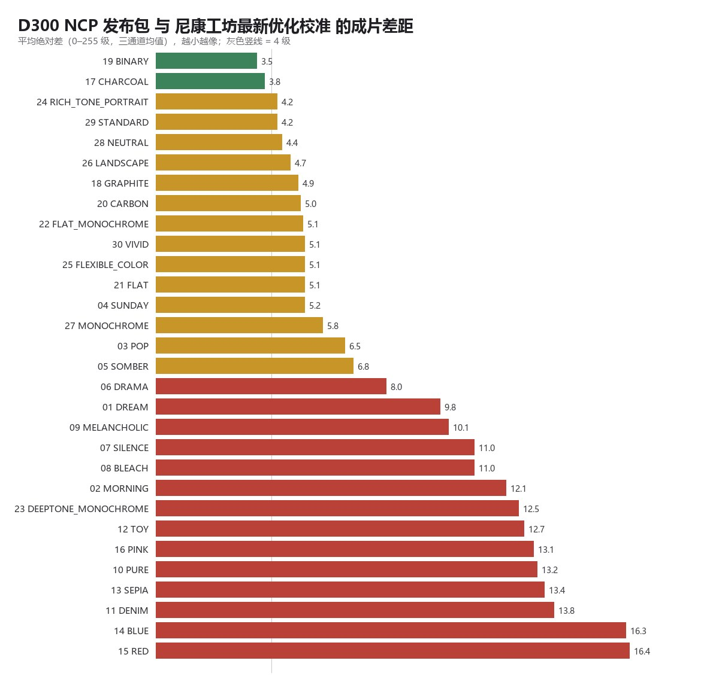

# D300 实机落地：NP2/NP3 → 带曲线 NCP，以及工坊引擎的曲线前变换

这是根目录 `README.md` 的**落地篇**。上层那篇回答「文件格式长什么样」，这一篇回答三个更实际的问题：

1. 生成出来的 `.NCP` 到底能不能在 D300 上被认出来、装进相机？（含卡上路径的固件实证）
2. 降级成 NCP 之后，新预设的影调还剩下多少？
3. 用 NX Studio（尼康工坊）预览时，为什么看到的和文件里写的不是一回事？

所有数字都来自实测：42 个原厂样本的独立复算、30 个生成文件的逐项体检、19 张工坊导出的像素级比对，
以及**最后三轮插卡实测（共 29 张实拍）**——曲线能不能执行、底子码该写什么、机身有没有工坊那层变换，
这三件事已经在真机上问死了（见 [docs/07-camera-verification.md](docs/07-camera-verification.md) 与第十二节）。

> 目录约定：`ncp/out/` 是按文件原意生成的 30 个 NCP；`ncp/out_comp/` 是抵消了引擎变换的补偿版；
> **`ncp/release/` 是正式发布包**（= 补偿版，已修为正确的底子码与滑块标志位，可直接拷卡）。
> 选哪一个在第 7 节与第 12 节有定案：**用 release / out_comp**。

---

## 一、结论速查

| 事项 | 结论 | 证据强度 |
|---|---|---|
| 卡上路径 | **`A:\NIKON\CUSTOMPC\PICCON%02d.NCP`**，不是卡根目录 | 固件字符串，唯一一条路径 |
| 52 字节配置布局 | 成立 | 独立复算 6 个原厂 NCP，字段全对 |
| 8 个滑块编码 `(b0-0x80)*b1/16` | 成立 | 96/96 字节命中 |
| NP2/NP3 → NCP 端到端 | 成立 | 12/12 逐字节一致 |
| 名字字段编码 | **ASCII 20 字节**（上层文档写作 UTF-16BE，需更正） | 原始字节直接可读 |
| 曲线记录头 8 字节 | **固定标识**，不是校验和 | 35 个不同曲线文件头部全同 |
| 自定义曲线是否被工坊执行 | **是** | 黑场/白场精确落在文件写的位置 |
| 20 个控制点是否被接受 | **是** | 工坊与导出均正常 |
| 工坊曲线前是否有固定变换 | **有，中间调 −18** | 探针 + 阶跃曲线双重验证 |
| **机内「载入」列表显示哪些文件** | **底子码必须与滑块类型一致**：彩色 `0x0001`、单色 `0x064D` | 三轮卡片包共 32 个文件，逐一记录是否出现在列表里 |
| **机身是否会执行 NCP 曲线** | **会**，但需要滑块标志位 | 原厂 M/S 只改名即生效，差 21.9 / 38.4 级 |
| **让曲线生效的开关** | 八个滑块的第 2、3 字节写 **`01 01`**（不是 `80 80`） | 116 个原厂文件：52B 全 `80 80`，638B 全 `01 01` |
| **机身固件是否也有该变换** | **有，且与工坊是同一个 H** | 阶跃交点 144.6（模型 146.1）；反推 H 差 +0.95±1.04 级 |
| 最终该发布哪一套 | **`ncp/release/`（= 补偿版）** | 端到端残差 ≤1.1/255 |
| **与「最新优化校准」的成片差距** | **平均 8.4 级；影调 ≤4.2 级，差距全在颜色** | 30 对同机位样片，逐像素比对（第 13 节） |
| 哪几支可以直接用 | 单色系 17–20 / 22 / 27（3.5–5.8 级） | 同上 |
| 哪几支是短板 | 调色 13–16（平均 14.8 级）：做成了「单色+浓调色」而非「低饱和+轻调色」 | 同上 |

---

## 二、卡上路径：固件里只有一条

上层文档把「机内载入」标为未验证，路径写成「大概是 `NIKON\CUSTOMPC`」。这个可以定案了。

在 D300 固件 `B3000111.bin` 里直接搜字符串：

```
0x1A1BEC  A:\NIKON\CUSTOMPC\PICCON%02d.NCP     ← 出现 6 次
0x1A1C74  A:\NIKON\CUSTOMPC\
```

再把固件里**所有** `X:\` 开头的路径串全部拉出来对照：没有根目录级的 NCP 路径，也没有「扫描整张卡」的写法。

这条结论的实际后果：把 `PICCONnn.NCP` 放在卡根目录时，写文件会成功（机身返回句柄），但机身的「载入／保存 → 复制到相机」列表是空的 —— 因为它只去 `CUSTOMPC` 里找。很多「导入没反应」的报告都是这个原因。

> 注意区分两件事：**工坊**的帮助文档说「卡根目录或 `NIKON\CUSTOMPC`」都能扫到，那是软件的行为；**机身固件**只有 `CUSTOMPC` 一条。不要用工坊的说法推翻固件的结论。

---

## 三、对上层格式结论的独立复算

为了不依赖仓库自带脚本，另写了一份解析器（`tools/` 里的审计脚本逻辑）从原始字节重算：

**复核通过**

- 52 字节配置：`NCP\0` + 记录类型 1/长度 36 + 版本 `0100` + 名字 20B + 底子 u16 + 未修改位 + `0xFF` + 8 滑块 + 4 字节零尾
- 滑块 `(b0-0x80)*b1/16`：6 个预设 × 2 代格式 = 96 个滑块值，**96/96** 与手算一致
- 端到端：NP2/NP3 → NCP，**12/12 与原厂 NCP 逐字节相同**
- 638 字节曲线：控制点与 LUT 互校（原厂 `S.NCP` 三点全部吻合到 0.1% 内）

**需要更正的四点**

| 上层文档的说法 | 实测 |
|---|---|
| 名字卡是 UTF-16BE | **ASCII 20 字节，补零**。按 UTF-16BE 解会得到乱码，仓库自带 `np2ncp.py` 因此把名字写成 `????`，它宣称的「12/12 一致」用发布版脚本跑是 **0/12** |
| 说明卡编码未标明 | **UTF-8**（解出来是 8 条原厂中文文案） |
| 单色调的「调色枚举」标为 `TONING_GUESS` 待确认 | 源文件里该卡是 `FF 00`（不适用），**信息不在文件里**，不是待确认而是无法从数据侧确认；只能按预设名指定 |
| 曲线「LUT 必须单调不减」 | 不是格式要求。原厂 `S.NCP` 自身就是升-降-升 |

**顺手补上一个原本列为「未解决」的项**：曲线记录头 8 字节 `49 30 00 FF 00 FF 01 00`，上层文档试了 4 种 CRC16 都不对。把 35 个曲线差别极大的 638 字节文件头部全拉出来统计 —— **完全相同**。它是固定标识，生成时照抄即可，不需要计算。

---

## 四、生成规则（`tools/ncp_d300.py`）

**底子码只有两个值可用，且必须与滑块类型一致**（真机三轮实测，见第十二节）：

| 滑块类型 | 底子码 | 说明 |
|---|---|---|
| 彩色（饱和度/色相为有效值） | `0x0001` | 标准 |
| 单色（饱和度/色相 = `FF FF`） | **`0x064D`** | 单色 |

D300 SDK §6.4.1「Format of the Picture Control Data」里的枚举是：

```
PicCtrlItem: 1: Standard, 2: Neutral, 3: Vivid, 4: Monochrome,
             101–199: Option（自定义位填「所依据的底子」）
```

但真机结果和这个枚举对不上，实测才是准的：

- `0x0001` + 彩色滑块 → **出现**
- `0x064D` + 单色滑块 → **出现**
- `0x0002 / 0x0003 / 0x0004 / 0x0005`（SDK 枚举里的中性/鲜艳/单色）→ **全部不出现**
- `0x0001` + 单色滑块、`0x0004` + 单色滑块 → **不出现**
- `0x03C2 / 0x00C3 / 0x0486 / 0x04C7`（新系统四位码，且滑块一致）→ **不出现**

写错底子码的文件是被**单独跳过**的，不会让枚举停下：同一张卡上混放 12 个文件时，
认得的照常列出、不认的静默消失（这也是当初误判成「0x064D 整条不显示」的原因 ——
那一批里所有 0x064D 文件恰好都配错了滑块）。

**⚠️ 需要更正上一版 `README` 的说法。** 早先这里写的是「底子只能用 1/2/3/4、不要用四位码」，
两次判断都反了：**单色必须写 `0x064D`，写 4 反而不认。**
`pick_base()` 已改为返回 `0x064D`。

**单色底子的滑块必须重排。** 原厂 `MONOCHROME.NCP` 是 `83 80 80 FF FF 80 80 FF`：
单色底子上没有「饱和度 / 色相」，这两位必须写 `FF`（不适用）；
反过来彩色底子没有「滤镜 / 调色 / 调色强度」，那三位写 `FF`。写错就与底子矛盾。
体检里加了这条自洽检查（单色却有饱和度 · 彩色却有滤镜 → 报错）。

**三个必须踩对的点**

1. **控制点不能等距撒**。双色、木炭这类曲线局部极陡（相邻两格跳 27/255），等距 20 点的重建误差 **51/255**。改成自适应布点（每轮在偏差最大处补点）后降到 **14.9/255**，其余预设全部 ≤3.1/255。
2. **控制点与 LUT 必须是同一条曲线**。机身按控制点重算，两条不一致时「显示的和生效的不是一回事」。验证阈值设在 1.5/255。
3. **端点不能强行归零**。仓库的测量脚本强制 `lut[0]=0`，但抬黑的预设（如梦幻实测黑场 ≈46/255）本该有偏移，强制归零等于在暗部硬切一刀。按邻段斜率外推修复，影响 8 个预设。

**生成结果**：30 个文件（`ncp/out/`），全部通过 12 项体检（结构、底子、滑块、控制点单调、端点断崖、控制点-LUT 一致性、整体重建误差）。

| 指标 | 结果 |
|---|---|
| 曲线重建误差（除双色） | ≤3.1/255 |
| 双色（接近阶跃的硬调曲线） | 14.9/255，20 点是尼康上限，已是最优 |
| 文件大小 | 638 字节（52 + 586 曲线 + 4 结束） |

---

## 五、工坊首轮实测：曲线确实被执行了

用同一张 `DSC_4513.NEF`，8 个预设各导出一张 JPG，与机身内嵌 JPEG（= 机身自己的渲染）逐档比对。

**关键证据：曲线的端点精确落在文件写的位置**

| 预设 | 曲线里写的 | 实测极值 |
|---|---|---|
| 平面 FLAT | 黑场抬到 14 | 最小 14 |
| 木炭 CHARCOAL | 黑场 23 / 白场 242 | 22 / 242 |
| 梦幻 DREAM | 黑场 47 | 42 |
| 双色 BINARY | 硬阶跃 | 中位 0、99% 分位 255 |

不是「画质变了一点」这种模糊现象，而是**机器可数的位置**。这同时确认了 20 个控制点被引擎接受（此前担心尼康原厂只用 3~4 点，会不会有上限）。

调色枚举也验了：`SEPIA` 出棕褐（枚举 1）、`PINK` 出粉紫（枚举 9），两个都猜对。

**但出现一个系统性偏差：中间调统一被压暗 20~25 级**

`STANDARD` 这条曲线本该把输入 100 映到 97，实测到 **71.4**；输入 128 该到 127.4，实测 **104.2**；而两端完全吻合（20→19.1、240→247.5）。

8 个滤镜全部同向、同量级 —— 排除「某条曲线做坏了」。

---

## 六、引擎的曲线前变换 H

### 模型

先在工坊里做两个标定探针：

- `T01_IDENT.NCP` —— 恒等曲线（x=y，20 个等距点）
- `T02_INVERT.NCP` —— 反相曲线（0→255、255→0，2 个点）

T01 套用后**不等于**机身：中间调暗 18 级，两端归零。而 T02 的输出**精确等于 `255 − T01`**，每档都在 1 级内。

这种对称关系只在一种结构下成立：

```
输出 = C( H(x) )        x  = 输入亮度（机内标准渲染）
                        H  = 引擎在曲线之前插入的固定变换
                        C  = 文件里的曲线
```

若 H 加在曲线之后，就需要 H 关于 127.5 反对称（x=120 偏差 −18 时 x=135 应为 +18），实测不是（−17.8）。**H 在曲线之前。**

### 实测 H



| 输入 x | 0 | 32 | 64 | 96 | 128 | 160 | 192 | 224 | 255 |
|---|---|---|---|---|---|---|---|---|---|
| H(x) | 0 | 26.3 | 51.9 | 79.2 | 110.2 | 142.8 | 181.4 | 218.7 | 255 |
| 偏差 | 0 | −5.7 | −12.1 | −16.8 | **−17.8** | −17.2 | −10.6 | −5.3 | 0 |

- 测量条件：921600 像素、其中 184262 个中性像素（色度 <0.12）、4 级分档取中位、62 个分档点
- **不是 gamma**：逐点反算的 g 从 1.03 漂到 1.24，不恒定
- **不是对比度 S 曲线**：暗部反而变亮（+2），高光也变亮，只有中间塌
- 两端精确归零（0→0、255→255），峰值偏差 **−18.2（输入 150）**

完整 62 点表见 `tools/compensate.py` 的 `H_PTS`。

### 模型验证

拿首轮那 8 个已导出的文件做交叉验证。残差 = 实测 − 模型预测，按 8 级分档取中位（单位 /255）：

| 预设 | `C(H(x))` 平均/最大 | `C(x)` 平均/最大 |
|---|---|---|
| 平面 FLAT | **1.0 / 2.7** | 9.0 / 18.4 |
| 梦幻 DREAM | **1.3 / 6.1** | 8.8 / 19.9 |
| 流行 POP | **1.7 / 8.1** | 10.6 / 22.1 |
| 标准(新) STANDARD | **2.2 / 9.4** | 12.9 / 26.3 |
| 木炭 CHARCOAL | **4.0 / 10.2** | 8.0 / 14.0 |
| 棕褐 SEPIA | **5.1 / 10.3** | 11.9 / 23.1 |
| 双色 BINARY | 5.5 / 79.2 ※ | 13.4 / 160.9 |
| 粉 PINK | 7.5 / 14.4 ※ | 17.1 / 32.8 |

※ 双色的最大值出现在阶跃点本身：阶跃处同一条 8 级分档区间内既黑又白，中位数随分档边界抖动，不是模型误差。※ 粉同时带调色，亮度通道被染色偏移污染。

### 最强的单点证据：双色阶跃

曲线是阶跃时，任何连续曲线的拟合都可能「碰巧接近」，但**阶跃位置不会骗人**：

| | 白像素（≥250）占比 |
|---|---|
| 实测 | **18.34%** |
| `C(H(x))` 预测 | **18.14%** |
| `C(x)` 预测 | 23.65% |

### 排除掉的三种怀疑

1. **底子选错**？NEF MakerNote 记录 `0100STANDARD`，原厂 `STANDARD.NCP` 底子码 `0x0001`，我方相同
2. **「与照相机兼容 / 最新的优化校准系统」两个引擎的差异**？参考导出与机身内嵌 JPEG 的 RMS 仅 2.7，差值不是引擎造成的
3. **控制点被引擎按等距误读**？T01 的 20 个点本身就是严格等距恒等，任何「等距重排」的解释都会还原成恒等

---

## 七、预补偿与两版文件

想要输出 `T(x)`，写进文件的曲线应为：

```
C' = T ∘ H⁻¹        C'(y) = T( H⁻¹(y) )
```

`tools/build_comp.py` 生成 `ncp/out_comp/`（30 个），并用实测 H 模拟引擎执行一遍：

| | 与目标曲线的偏差 |
|---|---|
| 未补偿（`ncp/out/`） | 最大 ≈18/255 |
| 补偿版（`ncp/out_comp/`） | **最大 1.84/255**（0.72% 亮度量程） |

H⁻¹ 的几个关键映射（写曲线时有用）：

| 想要输出 | 0 | 47 | 110 | 128 | 200 | 255 |
|---|---|---|---|---|---|---|
| 需要输入 | 0 | 58.2 | 127.5 | 146.1 | 207.7 | 255 |

**该用哪一版，已经测定了 —— 用 `out_comp/`（= `ncp/release/`）。**

判定工具 `ncp/packs/卡片包7/PICCON02.NCP`（`02 STEP`）：曲线在 v=128 硬阶跃、4 个控制点
`(0,0) (127,0) (128,255) (255,255)`，**故意不做补偿**。以同场景的机身标准优化校准为横轴分档，
看阶跃落在哪里：

| 输入区间 | 像素数 | 翻白比例 |
|---|---|---|
| 135–137 | 6 702 | 3.9% |
| 143–145 | 7 913 | 25.6% |
| **145–147** | 8 331 | **54.1%** |
| 147–149 | 9 125 | 78.0% |
| 151–153 | 11 124 | 92.7% |

线性拟合 50% 交点 = **输入 144.6**，模型预测 `H⁻¹(128) = 146.1`。
**机身确实也做这层 H。** 两版差 18 级，肉眼就能看出，但这里是用像素统计定的。

进一步用 gamma 0.45 把整条 H 从机身反推出来，与工坊的 H 对比：
**20 个采样点平均差 +0.95 级、标准差 1.04 级**（5–233 全影调）。
详见 [docs/07-camera-verification.md](docs/07-camera-verification.md) 与第十二节。

---

## 八、仍未解决

~~机身固件是否有 H~~ —— **已测：有，且与工坊同一个函数**（见第 7 节、第 12 节）。

1. **T02 的饱和色没有跟着反相**。逐通道反相模型在中性区 RMS 10.7，饱和区 62.7 —— 粉红上衣本应变成绿色，实测仍是粉红。说明彩色区域还有一层保护/替换逻辑未建模。不影响影调补偿（H 是在中性像素上拟合的，8 个彩色场景都验过），但意味着**高饱和区的颜色无法精确预测**。
2. **调色强度偏浓**。`SEPIA` 色度 20.3 对原厂 13.4。我方写在 `0x84`，原厂该位是 `0xFF`（不适用），`0x84` 出自仓库脚本，明显偏大，需要按实拍回调。
3. **双色阶跃点偏高**。白像素 18.8% 对原厂 23.5%，应更早开始跳 —— 与第 2 条同源（滑块与曲线的交互或被 H 影响）。
4. **高饱和创意的天花板**。`POP` 饱和度 15.5 对原厂 23.5。「梦幻 / 流行 / 牛仔布」这类预设的精髓是分色相区域的选择性色彩处理，D300 引擎只有全局工具，这是代际差，不是校准没做到。**影调可以像，味道不可能像。**

---

## 九、复现

```bash
# 1) NP2/NP3 + 曲线 -> NCP（未补偿）
python tools/ncp_d300.py build ../presets --curve ../output/curve_all -o ncp/out

# 2) 体检任意一批
python tools/ncp_d300.py verify ncp/out

# 3) 生成补偿版与探针
python tools/build_comp.py

# 4) 回比：把工坊「导出自定义优化校准」的目录判为「曲线是否完整保留」
python tools/cmp_ncp.py <导出目录> --out ncp/out

# 5) 自检补偿模型
python tools/compensate.py

# 6) 生成验证卡包（8 个槽位：阶跃 / gamma / 未补偿与补偿对照 / 单色+曲线）
python tools/build_pack7.py

# 7) 生成正式发布包（30 个，补偿版，可直接拷卡）
python tools/build_release.py
```

`tools/` 里另有三份分析脚本（`analyze.py` 影像统计、`pairs.py` 成对差异诊断、`probe_analysis.py` 模型对拍），依赖 `numpy` + `Pillow`。

---

## 十、目录

```
d300/
├── README.md                     本篇
├── docs/
│   ├── 01-format-verification.md      格式结论的独立复算与四处更正
│   ├── 02-workshop-test-round1.md     首轮 8 组实拍测试记录
│   ├── 03-probe-and-compensation.md   探针设计与 H 的推导
│   ├── 04-workshop-guide.md           工坊操作步骤（菜单文字已核对）
│   ├── 05-usage.md                    装机与使用说明
│   ├── 06-card-pack.md                插卡测试的卡片包与判读方法
│   └── 07-camera-verification.md      ★ 真机三轮验证：01 01 开关、底子码、机身 H 定案
├── tools/                        生成、补偿、体检、回比脚本
│   ├── build_pack7.py            生成验证卡包（8 个槽位）
│   ├── build_release.py          ★ 生成正式发布包（30 个，补偿版）
│   ├── compare_samples.py        ★ 成片对比：指标计算 + 并排出图
│   └── …
├── samples/                      ★ 30 对实拍样片对比（第 13 节）
│   ├── README.md                     对比报告（表 + 归因 + 下一步）
│   ├── workshop/                     工坊「最新优化校准」导出（600px）
│   ├── d300ncp/                      发布包滤镜导出（600px）
│   ├── compare/                      左右并排图，标题栏带该滤镜全部指标
│   ├── metrics.csv                   完整数值
│   └── ranking.jpg                   按平均差排序的条形图
├── ncp/
│   ├── release/                  ★ 正式发布包：NIKON/CUSTOMPC/PICCON01–30（可直接拷卡）
│   ├── out/                      30 个 NCP（按文件原意，未补偿）
│   ├── out_comp/                 30 个 NCP（抵消 H）
│   ├── packs/卡片包7/            第三轮验证包（8 个：阶跃 / gamma / 未补偿·补偿对照 / 单色+曲线）
│   ├── probes/                   T01 恒等 / T02 反相 / T03 无曲线 / T04 补偿恒等 / T06 阶跃
│   ├── test-packs/pack1,pack2/   首两轮实测用的小包
│   ├── card-pack/                早期 12 槽卡片包
│   └── MANIFEST.txt              槽位-预设-底子对照
└── charts/
    ├── engine-h-curve.png        H 的实测曲线
    ├── name-map.png              英文名（机身/工坊显示）→ 中文名 → 槽位
    ├── tonal-reference.png       各预设的预期影调
    └── side-by-side.jpg          8 组「我方 NCP vs 原厂新版」实拍并排
```

原始 NEF 与全尺寸导出 JPG 未入库（体积原因），复现所需的中性分档统计可由 `tools/probe_analysis.py` 在任何同场景导出上重跑。

---

## 十一、给上游脚本的修改建议

仓库根目录的 `np2ncp.py` / `np2ncp_curve.py` 有两处会影响结论复现：

1. **名字卡按 UTF-16BE 解码** → 应改为 `ASCII`，否则生成的名字是 `????`，「12/12 逐字节一致」无法复现
2. **曲线测量脚本强制 `lut[0]=0`** → 应在端点上按邻段斜率外推，否则抬黑的预设会凭空多出暗部断崖

另外，`output/curve_all/` 那批文件的**控制点被加了「人像专用」的 +14…+17.7 修正量，而 LUT 没加**。机身按控制点重算，所以实际生效的曲线与文件里的 LUT 不是同一条（中间调偏亮约 6.7%）。本目录的 `ncp/out/` 是从 `output/curve_all/` 的 LUT 重新采样控制点得到的，两者天然一致。

---

## 十二、机身实测定案：三个字节定生死

前三轮插卡走了一圈弯路，最后落在三件很具体的事上。完整过程与逐张照片数据见
[docs/07-camera-verification.md](docs/07-camera-verification.md)。

```text
1. 638 字节曲线要被执行，八个滑块的 [41][42] 必须写 01 01（不是 80 80）
2. 单色底子码必须是 0x064D，彩色必须是 0x0001
3. 机身在套曲线之前也做了工坊那个 H，而且和工坊是同一个函数
```

### 1. 曲线的开关：滑块第 2、3 字节

把尼康原厂的 `M.NCP`、`S.NCP` **一个字节不改、只改名字**丢进卡里，机内效果极明显
（与标准底子的平均差 21.9 / 38.4 级）；而同一批里我方自己的 gamma 曲线只差 1.49 级 —— 等于没动。
原厂能跑、我方不能跑，问题只可能在写法。

统计仓库里 116 个原厂 NCP 的八个滑块：

| 文件类型 | 数量 | `[41]` | `[42]` |
|---|---|---|---|
| 52 字节（无曲线） | 49 | `80` | `80` |
| 638 字节（有曲线） | 62 | **`01`** | **`01`** |

**无一例外。** `[41]` 是对比度、`[42]` 是亮度，编码规则 `(b0-0x80)*b1/16` 里 `0x01` 不是"数值"
而是**哨兵**，含义是"这一项交给自定义曲线"。写 `0x80`（数值 0 = 线性）时机身按线性对比度出图，
后面那 578 字节曲线块被**静默丢弃**：不报错、不提示、文件也照常显示在列表里。

> 前几轮的探针用了 `SL_STD = [0x83,0x80,0x80,0x80,0x80,0xFF,0xFF,0xFF]` —— 全踩在这个坑上。
> 而 `tools/ncp_d300.py` 的 `sliders_for(has_curve=True)` 一直写的是 `0x01 0x01`，
> 也就是说 `ncp/out/`、`ncp/out_comp/` 那 60 个正式滤镜从第一版起就是对的，只是从来没用它们测过。

改成 `01 01` 后立竿见影：`03 GAM`（gamma 0.45）的实测亮度均值从 53.6 抬到 **95.8**，
中间调 15.3 → **67.1**，与 `LUT(H(x))` 预测逐点吻合。

### 2. 底子码：单色必须 0x064D

12 槽对照包里只有 5 个出现在机身列表里，规则是**底子码必须合法且与滑块类型一致**：

| 滑块类型 | 必须写的底子码 |
|---|---|
| 彩色（饱和度/色相为有效值） | `0x0001` |
| 单色（饱和度/色相 = `FF FF`） | `0x064D` |

`0x0000 / 0x0002 / 0x0003 / 0x0004 / 0x0005` 一律不认（写错的文件是被**单独跳过**，
不会让枚举停下 —— 同一张卡上混放没问题）。
顺带纠正上一版 `README` 里「底子编号只能用 1/2/3/4」的说法：**单色恰恰不能用 4**。
`tools/ncp_d300.py` 的 `pick_base()` 已改为返回 `0x064D`，`ncp/out/`、`ncp/out_comp/`
里 22 个单色文件也已就地修正。

这一条同时解决了「单色能不能带曲线」：`06 U-BIN`、`07 C-BIN`（`0x064D` + 曲线）出图 \|R−B\| = 0.00，
`08 U-SEP`（`0x064D` + 曲线 + 棕褐调色）\|R−B\| = 41.8 —— **三者可以共存**。

### 3. 机身 H ≡ 工坊 H

硬阶跃 50% 交点落在**输入 144.6**（模型 `H⁻¹(128) = 146.1`，若无 H 应落在 128）。
再用 gamma 0.45 把整条 H 从机身反推，与工坊 H 逐点对比：**平均差 +0.95 级、标准差 1.04 级**。

推论很实用：**补偿只需做一份**。卡里出图和工坊出图是同一个结果，不用维护两套文件。

端到端校验（`POP` 的未补偿/补偿两版）：未补偿版对 `T(H(x))` 残差 0.93，
补偿版对 `T(x)` 残差 1.10 —— 都在 JPEG 量化噪声量级。**所以发布补偿版。**

### 4. 正式发布包

`ncp/release/NIKON/CUSTOMPC/PICCON01–30`（638 字节、`01 01`、底子码已按类型校验）。
拷到卡根后机身「载入/保存 → 复制到相机」即可。

> **机身只有 9 个自定义槽位（C-1…C-9）**，依据 SDK §5.5.14.1「From 201 to 209:
> Custom picture control area (from 1 to 9)」。30 个请分 4 批导入：01–09 / 10–18 / 19–27 / 28–30。
> 卡上的文件不必删，机身列表始终显示全部 30 个。

滤镜清单：

| 槽位 | 名字 | 底子 | 槽位 | 名字 | 底子 | 槽位 | 名字 | 底子 |
|---|---|---|---|---|---|---|---|---|
| 01 | DREAM | 标准 | 11 | DENIM | 标准 | 21 | FLAT | 标准 |
| 02 | MORNING | 标准 | 12 | TOY | 标准 | 22 | FLAT_MONOCHROME | 单色 |
| 03 | POP | 标准 | 13 | SEPIA | 单色 | 23 | DEEPTONE_MONOCHROME | 单色 |
| 04 | SUNDAY | 标准 | 14 | BLUE | 单色 | 24 | RICH_TONE_PORTRAIT | 标准 |
| 05 | SOMBER | 标准 | 15 | RED | 单色 | 25 | FLEXIBLE_COLOR | 标准 |
| 06 | DRAMA | 标准 | 16 | PINK | 单色 | 26 | LANDSCAPE | 标准 |
| 07 | SILENCE | 标准 | 17 | CHARCOAL | 单色 | 27 | MONOCHROME | 单色 |
| 08 | BLEACH | 标准 | 18 | GRAPHITE | 单色 | 28 | NEUTRAL | 标准 |
| 09 | MELANCHOLIC | 标准 | 19 | BINARY | 单色 | 29 | STANDARD | 标准 |
| 10 | PURE | 标准 | 20 | CARBON | 单色 | 30 | VIVID | 标准 |

---

## 十三、成片对比：30 对样片把差距量出来了

前十二节证明的是「文件能被机身吃下、曲线能被执行」。这一节回答另一个问题：
**成片到底像不像？差在哪？** 完整数据、逐支分析见 [samples/README.md](samples/README.md)。



### 怎么测的

同一张 RAW（`DSC_3891.NEF`，人像/车展，2848×4288）导出两套：
一套挂 NX Studio 的「最新优化校准」（Z 系统那一代），一套挂本仓库 `ncp/release/` 里的
补偿版 NCP。同裁切、同尺寸、像素严格对齐（实测最佳位移 0,0），所以可以逐像素直接减。

- `samples/workshop/` 与 `samples/d300ncp/` 是同一滤镜名的两版，文件名 `NN_滤镜名.jpg`；
- `samples/compare/` 是并排图，标题栏直接写着该滤镜的五个指标。

编号规律：工坊那侧导出为 `_30.._59`（= 滤镜 01–30），我方那侧**无后缀那张是 01**、
之后 `_01.._29` 是 02–30。**30 对齐全**（早期版本误记「01 DREAM 缺我方样片」，
实际无后缀那张就是 DREAM，已用一对一比对确认）。

口径：**平均差** = 三通道逐像素绝对差均值（0–255 级）；**影调 RMS** = 按参考亮度分 16 档后
各档中位输出的偏差均方根（这个才反映曲线形状，ΔL 会被明暗抵消）。

### 结论：影调可以做到"几乎一样"，颜色只能"神似"

| 分组 | 数量 | 平均差 | 状态 |
|---|---|---|---|
| 单色 17–20（木炭 / 石墨 / 双色 / 黑碳） | 4 | **4.3 级** | 可直接用 |
| 新系统 21–30 | 10 | 5.6 级 | 可用（23 深色调单色除外） |
| 彩色创意 01–12 | 12 | 10.0 级 | 影调对，颜色不对 |
| 调色 13–16（棕褐 / 蓝 / 红 / 粉） | 4 | **14.8 级** | 结构性做错，需重做 |

全部 30 支：平均 8.4 级、中位 6.7 级、SSIM 0.915–0.995。
**平均亮度偏差全部落在 ±4.2 级内（中位 1.4）、影调 RMS 中位 3.6 级** —— 曲线这一层已经过关；
差距几乎全部来自颜色。

`DREAM` 是其中最干净的一例：影调 ΔL 只有 **+0.7 级**、影调 RMS **2.2 级**（彩色滤镜里最准），
彩度比 1.15×，但偏色 **−26** —— 平均差 9.8 级里九成来自这一层暖调色罩。

### 差距的四个来源

1. **饱和度滑块全是 `0x80`（数值 0）**。原版 `SILENCE` / `BLEACH` / `DRAMA` 靠大幅降饱和出效果
   （我们的彩度是原版的 2.9–4.4 倍），`POP` / `DENIM` / `TOY` 靠提饱和（我们只有 0.71–0.87 倍）。
   这一项改起来最简单 —— 源文件里本来就有饱和度参数，只是生成时被写成了 0。
2. **色罩做不出来**。`PURE` 偏色差 **+32**、`DENIM` +31、`MORNING` +27、`DREAM` −26。
   NCP 的曲线是**单条亮度 LUT**，没有分通道曲线，「整体压向青灰/暖黄」这种手法无处安放。
   `MORNING`（彩度比 0.95）和 `DREAM`（影调 RMS 2.2）的差距**全部**来自这一项。
3. **13–16 的路线错了**。我们把它们做成「单色底子 `0x064D` + 浓调色 `0x84`」= 纯双色调，
   原版是「低饱和、仍留部分色彩 + 轻调色」。彩度比 0.26–0.81×（`RED` 只剩 26%，原版残留的彩色被
   我们抹掉了），`BLUE` 偏色 −36。视觉上是「黑白照片染色」对「彩色照片褪色再染色」。
4. **`DEEPTONE_MONOCHROME` 只给了整体 S 曲线**，原版是「压中间调 + 提高光」的局部反差，
   影调 RMS 16.4，是全部里影调最不准的一支。

另有一个系统性小偏差：所有彩色滤镜 ΔL 都在 **+1.0 ~ +3.5**（我们略亮），离散很小 ——
D300「标准」底子与新系统「标准」在高光端的固有差异，下一版统一压 1–2 级即可。

### 还能改进到什么程度

| 改法 | 目标 | 预期 |
|---|---|---|
| 把饱和度 / 色相滑块按源文件写进去 | 01–12 的 A、B 两组 | 彩度比拉回 ~1.0，这 12 支有望从 10 级降到 5 级内 |
| 13–16 改成「彩色底子 + 低饱和 + 轻调色（强度 `0x82`）」 | 当前最大短板 | 14.8 → 7–9 级 |
| DEEPTONE 单独拟合带拐点的曲线 | 23 | 12.6 → 6 级左右 |

**做不到的**：分离色罩（暗部加青、高光保持中性）、分色相区域的饱和度控制、只给中间调上色的
「部分调色」。这三样是新系统 Creative Picture Control 的招牌手法，D300 的自定义曲线只有一条亮度 LUT，
物理上没有对应物。所以最终定位是：**单色系可以直接用，彩色创意类当"同风格的近似版"，不是复刻版。**

