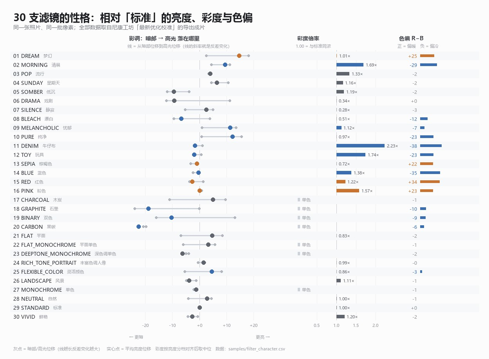

# 每支滤镜自己长什么样（性格表），以及一条残差定律

> 状态（2026-11-01）：**已完成**。数据 `samples/filter_character.csv`，图 `charts/filter-character.jpg`。
> 一句话：把 30 张原版渲染逐支和**原版 STANDARD**相减，得到"这支滤镜把画面往哪推"；
> 再拿它和第三版的残差对照 —— **残差与色罩强度的相关系数 r = 0.80（彩色底 26 支 r = 0.85），
> 与彩度偏、亮度偏几乎无关（0.03 / −0.03）**。

---

## 一、为什么还要做这一张表

第 13、14 节算的都是「我们 vs 原版」：每支差几级、差在亮度还是颜色。

这张表反过来，算「原版 vs 原版」：

```
f_k = 滤镜 k 的原版渲染  −  STANDARD 的原版渲染
```

得到的不是误差，而是**这支滤镜自身的位移**——它把画面推亮还是压暗、压的是暗部还是高光、
彩度给到几倍、往暖还是往冷。有两个用处：

1. **挑滤镜**：30 支里有好几支看起来很像，靠名字分不出浓淡与冷暖；
2. **解释残差**：把"位移幅度"和"我们还原的误差"放在一起，就能看出**到底是什么在卡住还原**。

---

## 二、口径

| 项 | 做法 |
|---|---|
| 底片 | `DSC_3891`（人像 / 车展，与第 13 节同一张，同机位、同裁切） |
| 输入 | `samples/workshop/` 的 30 张原版导出（长边 600px） |
| 基准 | `samples/workshop/29_STANDARD.jpg`（原版 STANDARD 的同帧导出） |
| 色彩空间 | **CIELAB / D65**，逐像素 |
| 遮罩 | 两张图都不过曝也不死黑（`8 < min(RGB)`、`max(RGB) < 247`），**同一批像素同时用于两张图** |
| 彩度 | **按基准亮度分 8 档，逐档算 C\* 比，再取中位**（不能直接取全图均值，原因见下） |

彩度这一步必须对齐亮度：C\* 本身随 L\* 走，画面一压暗，全图 C\* 均值就会掉。
直接相减会把「压暗」误读成「降饱和」。按亮度分档后再比，受影响的主要是那四支
「单色底子 + 着色」的调色滤镜（`BLUE` 1.03 → 1.38×、`PINK` 1.29 → 1.57×）。

> **限制**：这是**一张照片**上的位移。同一支滤镜拍灰墙和拍红花，"彩度倍率"当然不一样。
> 表里比较的是**同一张照片上各支之间的相对关系**，不是滤镜的绝对参数。

---

## 三、一张图看完



左栏是影调：灰线两端 = 暗部与高光的位移，线的**斜率**就是反差变化（暗部压得比高光多 = 加反差）；
中间的实心点 = 全画面平均亮度位移。中栏是彩度倍率，右栏是色偏。

---

## 四、全表

ΔL\*、暗/中/高三个分段的单位都是"级"（1 级 ≈ 1 个 L\* 单位）。最后一列是第三版与官方的平均差，用来对照。

| 槽 | 滤镜 | 平均 ΔL\* | 暗部 | 中间调 | 高光 | 彩度 | 色偏 | 第三版残差 |
|---|---|---|---|---|---|---|---|---|
| 1 | DREAM<br>梦幻 | +14.6 | +18.1 | +12.0 | +2.5 | 1.01× | 暖 +25 | 9.4 |
| 2 | MORNING<br>清晨 | +9.5 | +11.2 | +8.0 | +4.5 | 1.69× | 冷 -29 | 11.8 |
| 3 | POP<br>流行 | +4.0 | +3.9 | +4.2 | +3.4 | 1.33× | — | 4.3 |
| 4 | SUNDAY<br>星期天 | +6.4 | +4.4 | +9.3 | +10.6 | 1.16× | — | 3.7 |
| 5 | SOMBER<br>低沉 | -9.4 | -11.9 | -8.5 | -3.8 | 1.19× | — | 5.8 |
| 6 | DRAMA<br>戏剧 | -9.3 | -12.1 | -9.4 | +11.2 | 0.34× | — | 5.5 |
| 7 | SILENCE<br>静寂 | +2.6 | +5.0 | +0.7 | -5.2 | 0.28× | — | 6.4 |
| 8 | BLEACH<br>漂白 | -6.7 | -9.5 | -7.0 | +3.9 | 0.51× | 冷 -12 | 7.6 |
| 9 | MELANCHOLIC<br>忧郁 | +11.4 | +13.5 | +11.0 | +0.9 | 1.12× | 冷 -7 | 8.1 |
| 10 | PURE<br>纯净 | +12.2 | +15.5 | +10.0 | +0.8 | 0.97× | 冷 -23 | 10.8 |
| 11 | DENIM<br>牛仔布 | -1.6 | -1.5 | -2.6 | +1.0 | 2.23× | 冷 -38 | 13.2 |
| 12 | TOY<br>玩具 | -1.9 | -2.2 | -2.2 | +0.7 | 1.74× | 冷 -23 | 11.7 |
| 13 | SEPIA<br>棕褐色 | -1.0 | -0.9 | -0.3 | -3.3 | 0.72× | 暖 +22 | 7.1 |
| 14 | BLUE<br>蓝色 | -0.4 | -0.1 | -0.3 | -2.4 | 1.38× | 冷 -35 | 6.2 |
| 15 | RED<br>红色 | -2.7 | -3.7 | -2.2 | +1.4 | 1.23× | 暖 +34 | 11.4 |
| 16 | PINK<br>粉色 | +0.0 | -0.1 | -0.0 | +0.8 | 1.57× | 暖 +23 | 7.4 |
| 17 | CHARCOAL<br>木炭 | +4.9 | +9.6 | +1.8 | -11.0 | — | — | 1.9 |
| 18 | GRAPHITE<br>石墨 | -18.9 | -23.9 | -22.4 | -0.0 | — | 冷 -10 | 3.1 |
| 19 | BINARY<br>双色 | -10.3 | -16.0 | -15.1 | +13.1 | — | 冷 -9 | 3.5 |
| 20 | CARBON<br>黑碳 | -22.4 | -19.7 | -25.2 | -20.7 | — | 冷 -6 | 2.7 |
| 21 | FLAT<br>平面 | +4.7 | +8.5 | +1.6 | -6.8 | 0.83× | — | 3.1 |
| 22 | FLAT_MONOCHROME<br>平面单色 | +3.3 | +5.7 | +2.1 | -6.0 | — | — | 1.9 |
| 23 | DEEPTONE_MONOCHROME<br>深色调单色 | -6.2 | -3.9 | -10.6 | -4.9 | — | — | 8.8 |
| 24 | RICH_TONE_PORTRAIT<br>丰富色调人像 | +1.6 | +2.0 | +1.6 | -0.6 | 0.99× | — | 3.4 |
| 25 | FLEXIBLE_COLOR<br>灵活颜色 | +4.5 | +8.2 | +1.4 | -5.4 | 0.86× | 冷 -3 | 3.4 |
| 26 | LANDSCAPE<br>风景 | -3.9 | -4.8 | -3.4 | -1.2 | 1.11× | — | 3.6 |
| 27 | MONOCHROME<br>单色 | -1.2 | -1.9 | +0.3 | -2.0 | — | — | 3.0 |
| 28 | NEUTRAL<br>自然 | +2.8 | +4.3 | +2.2 | -4.1 | 1.00× | — | 3.2 |
| 29 | STANDARD<br>标准 | +0.0 | +0.0 | +0.0 | +0.0 | 1.00× | — | 3.5 |
| 30 | VIVID<br>鲜艳 | -2.6 | -4.3 | -1.1 | -0.7 | 1.20× | — | 4.1 |

（色偏写"—"表示 |R−B| < 3 级，视觉上算中性。）

---

## 五、六种典型

表里 30 行其实只有几种动作，看名字对不上的地方正好由此对齐：

1. **整幅提亮 + 暖雾**：`DREAM` 平均 +14.6，暗部 +18.1、高光只 +2.5 ——
   提的是暗部，画面像蒙了一层暖调薄雾（色偏 +25）。这就是第 13 节说"影调几乎一样、独独差一层色罩"的原因：
   曲线能把提亮做对（暗部多提、高光少提），暖雾做不了。
2. **整幅提亮 + 冷雾**：`PURE`（+12.2 / 冷 −23）、`MORNING`（+9.5 / 冷 −29）、`MELANCHOLIC`（+11.4 / 冷 −7）。
   三支都是"亮起来、泛灰蓝"，`MORNING` 还额外把彩度推到 1.69×。
3. **压暗 + 加强反差**：`DRAMA`（暗 −12.1、高 +11.2，反差 +23）、`BINARY`（暗 −16.0、高 +13.1）、
   `GRAPHITE`（暗 −23.9、高 −0.0）。这一类曲线的斜率变化远大于亮度位移，我们的端点外推就是冲它们改的。
4. **单纯压暗**：`CARBON` 平均 −22.4，三段一起压，是全部里最暗的一支；`SOMBER` −9.4 同理。
5. **大幅降饱和**：`SILENCE` 0.28×、`DRAMA` 0.34×、`BLEACH` 0.51×。D300 的饱和度滑块 −3 档
   实测只能压到 0.648×（第 14 节），**这三支从机制上就压不到**，只能靠曲线把亮度搬对。
6. **大幅升饱和**：`DENIM` 2.23×、`TOY` 1.74×、`MORNING` 1.69×。降比升更有力
   （−3 档 = 0.648×，压掉 35%；+3 档 = 1.275×，只加 27.5%），但离 2.23 仍差得远。

单色系（17–20、22、23、27）的彩度是 0，它们的位移全在影调上 —— 所以这几支的残差只有 1.9–8.8 级，
也是为什么"单色系可以直接用"。

---

## 六、残差定律：剩下的差距，八成是色罩

把上表的 `|色偏|` 和第三版的残差（`samples/metrics.csv` 的 `e_v3`）画在一起，关系非常干净：

| 统计 | 相关系数 | 说明 |
|---|---|---|
| 残差 vs \|色偏\|（全部 30 支） | **r = 0.795** | 秩相关 0.670 |
| 残差 vs \|色偏\|（彩色底 26 支） | **r = 0.850** | 去掉四支"单色底 + 着色"的调色滤镜 |
| 残差 vs \|彩度 − 1\| | r = 0.031 | **无关** |
| 残差 vs \|ΔL\*\| | r = −0.030 | **无关** |

线性拟合（全部 30 支）：

```
残差 ≈ 3.65 + 0.217 × |色偏|          R² = 0.63
```

读法：

- **3.65 级是地板**。色偏为零的滤镜（STANDARD / NEUTRAL / RICH_TONE / LANDSCAPE / MONOCHROME）
  残差全部落在 2.98–3.63 级 —— 这就是"影调 + 全局彩度"这套工具能做到的极限。
- **每 10 级色罩换 2.2 级残差**。`DENIM` 色偏 −38、残差 13.2；`MORNING` −29、11.8；`PURE` −23、10.8。
- **彩度和亮度已经不再是瓶颈**。第三版之后，残差和"这支滤镜浓不浓、亮不亮"几乎不相关了
  （r = 0.03 / −0.03）；饱和度滑块那一轮（第二版）把这块吃干净了。

### 一个例外：四支调色滤镜

13–16（SEPIA / BLUE / RED / PINK）挂在单色底子上，靠**着色档**出颜色。它们能**原生造出色罩**，
所以色偏对残差的伤害小得多（这四支 r 只有 0.35，n=4 不具统计意义，但方向清楚）：
`BLUE` 色偏 −35，残差只有 6.2；而同样 −38 的 `DENIM` 是 13.2。

代价是它们丢掉了"保留部分色彩"：着色是单一色相的一维着色，原版是"低饱和 + 保留部分彩色"。
所以这四支反过来卡在彩度比上（0.72–1.57×）。

> 一句话：**彩色底子做不出色罩，单色底子做不出彩色。** 两条路各缺一半，
> 而第 16 节的固件证据说明 D300 只有这两条路（四个底子共用同一套色彩处理）。

---

## 七、复现

```bash
python tools/filter_character.py          # 算指标 + 出图
```

| 产物 | 内容 |
|---|---|
| `samples/filter_character.csv` | 30 行：ΔL\*、三分段、彩度、色偏、黑白场、反差 |
| `charts/filter-character.jpg` | 上面那张哑铃图 |
