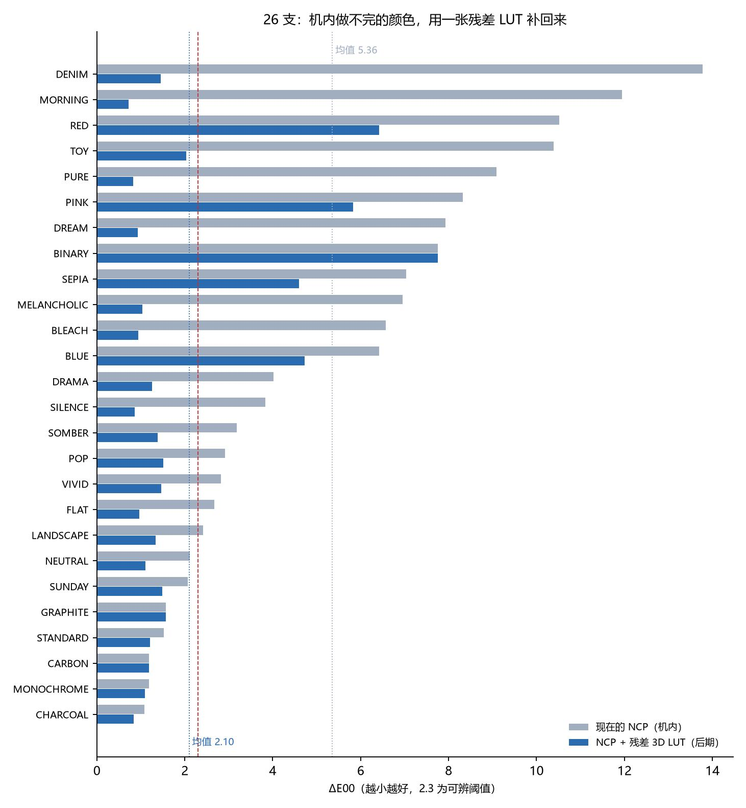
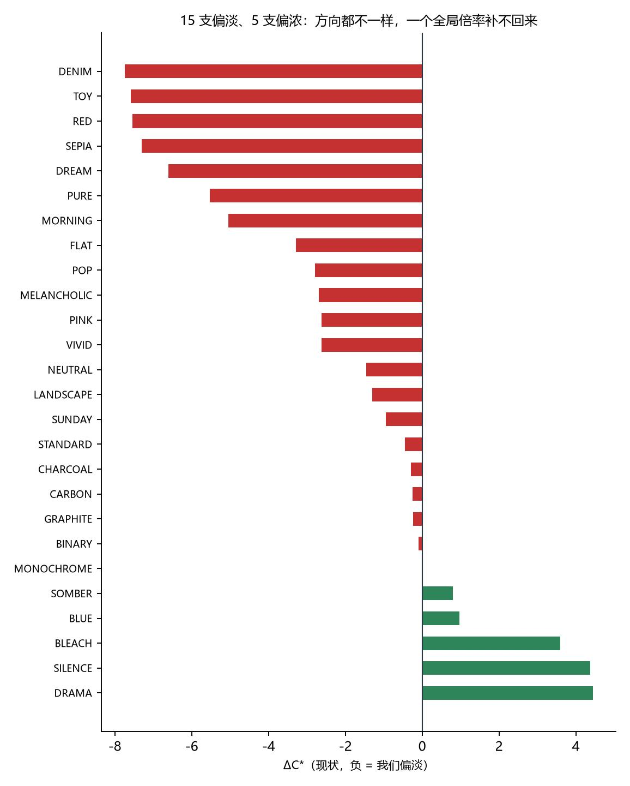
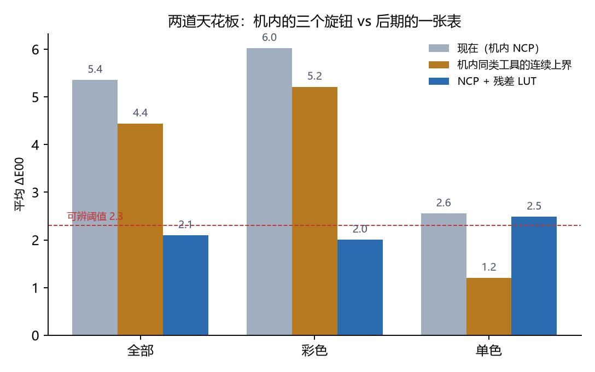

# 18 · 机内的天花板，与一张后期 3D LUT

> 状态（2026-11-02）：两个数都拿到了。
> **机内**：把「任意曲线 + 连续饱和度 + 连续色相」放到最优，26 支平均 ΔE00 只能
> 5.36 → **4.44**（彩色 6.02 → 5.21）。
> **2026-11-02 11:45 复核**：滑块其实被硬钳在 ±3，把搜索区间换成实测可达值
> （k 0.648–1.275、θ ±11.5°）重跑，可达上界 **4.43** —— 与理想值只差 0.01。
> 三格字节（底子、饱和度、命名空间）已全部实测关闭，见 `20`。
> **后期**：把残差本身拟合成一张 13³ 查找表，ΔE00 5.36 → **2.10**、平均差
> 6.45 → **3.18 级**，2×2 分块留出 **2.13**（几乎没过拟合）。
>
> 一句话：**影调和一大半颜色都能贴合；剩下的那一层不是「没调好」，是机内那三个
> 全局旋钮表达不了逐色相的三维映射。** 机内继续拧螺丝的空间约 0.9 个 ΔE00，
> 再往下要靠后期一张表 —— 除非第六节那两个字节自由度成立。



---

## 一、残差卡在哪一层（先把账算清）

`14-slider-calibration.md` 已经证明：饱和度/色相两个滑块在真机上按
「每档彩度 ×1.118、每档色相 3.83°」工作，7×7 整数档穷举下来**0 支值得改**。
`charts/real-gap.html` 那一版又把残差拆开：|ΔL\*| 1.77（影调已对平）、|ΔC\*| 4.51。

所以「还能不能优化」这个问题必须拆成两个：

1. **同样是这三个旋钮，还有没有更好的取值？**（= 上界在哪）
2. **这三个旋钮到底能不能表达原版的效果？**（= 天花板是不是结构性的）

第一个问题以前是拿模型算的，第二个问题是拿「原版底子在固件里」解释的。
两个都缺一个硬数，本文补上。



---

## 二、机内的上界：给足自由度能到多少（`oracle_global.py`）

不做整数档穷举（做过，结论 0 支），而是**给到极限**：

- **曲线**：任意单调映射 —— 直接按 L\* 分位数把我们的分布搬到目标的分布，
  等于「曲线随便画」，不受 257 点表、不受 H 变换约束
- **饱和度**：连续倍率 k，不限 ±3 档
- **色相**：连续转角 θ，不限 ±3 档

三者交替（曲线 → 网格搜 k/θ → 再曲线）三轮收敛，在全像素上复核。
这是**同类工具的上界**，真机只会更差（整数档 + H 变换 + 曲线表量化）。

| 组 | 支数 | 现在 ΔE00 | 上界 ΔE00 |
|---|---|---|---|
| 全部 | 26 | 5.36 | **4.44** |
| 彩色 | 21 | 6.02 | **5.21** |
| 单色 | 5 | 2.55 | **1.21** |



三个读法，都很具体：

### 2.1 单色 5 支其实没到顶，而且差得最多

单色组 2.55 → **1.21**，其中 `BINARY` 一支从 7.75 掉到 **1.67**。
纯灰度画面只有一维信息，一条曲线**本该够用** —— 它现在对不上，说明问题在
「曲线本身是拿另一个底片（DSC_3891）的模型拟合出来的」，不在引擎能力。
这一支的修法是重拟合曲线，不是换工具。

### 2.2 彩色 21 支：能拿到的不多，而且大半卡在档位范围上

6.02 → 5.21，只有 0.8。逐支看更清楚：需要大幅降彩度的几支，最优 k 落在
**0.64**（DRAMA、SILENCE、BLEACH、DENIM），而 ±3 档实测能给的区间是
**0.648–1.275**。也就是说：

> 这几支要的力度**已经超出滑块能给的范围**。它们现在全都已经顶在 −3 档上。

而 NCP 里饱和度是一个 `数值 + 0x80` 的有符号字节，格式上到 ±126 ——
**菜单只给 ±3，字节从来没人测过**。第六节的 `R1–R4` 就是去测这一格。

### 2.3 别被 ΔE00 骗：有一类「改善」是降饱和掩盖色相误差

`DENIM` 的 k=0.64：ΔE00 从 13.78 降到 12.42，看着是收益。但它本来
**偏淡 7.7 级**，再压 36% 彩度只会更淡 —— 收益来自「色相误差 57.6° 在低彩度下
不再刺眼」，不是更像。这类「收益」在本文一律不算数，选 LUT 时也不靠它。

结论：机内不是「到顶」，是**剩下的空间要三样东西才拿得到**——
真渲染重拟合曲线（单色那 5 支）、超出 ±3 的档位（4 支偏浓的）、底子那一层。

> **后两样已经实测关闭**（2026-11-02 11:45，见 `22-in-camera-ceiling-locked.md`）：
> 饱和度字节硬钳在 ±3（−6、−9 与 −3 逐像素相同）；第 38 字节写 0x08 必崩，
> `kind` 取自 `[profile+0x1b0]` 而非文件字节，创意底子在 NCP 里无法表达。
> 把 `oracle_global.py` 的搜索区间换成实测可达值（k 0.648–1.275、θ ±11.5°）重跑，
> 26 支上界 **4.43**（彩色 5.20 / 单色 1.21）—— 与上面那个不计档位的 4.44
> **只差 0.01**。所以第二节那个数不是「乐观估计」，它就是现实。
> 三样里只剩第一样（曲线重拟合）还有货，且只对单色 5 支有效。

---

## 三、把残差本身拟合掉（`lut_fit.py`）

### 3.1 为什么 3D LUT 是对的工具

残差不是「某个参数偏了」，而是一张**输入 RGB → 目标 RGB 的三维映射**：
同一个颜色，无论出现在画面的哪里，都该被搬到同一个地方。机身那套工具
（一条亮度曲线、一个彩度倍率、一个色相角）是这张映射里非常小的一个子集；
3D LUT 是它的超集。所以这不是「绕过问题」，是把机内表达不了的那一维补上。

### 3.2 怎么拟合

- **13³ 三线性网格**（2197 格 × 3 通道），从 5³ → 9³ → 13³ 逐级初始化
- 每轮：在当前网格上预测 → 残差按三线性权重摊回格子 → 阻尼 0.5 更新
- **信任域 ±40 级**：每格不得偏离恒等超过 40 级。这一条不是保守，
  是必需的 —— 去掉之后稀疏色域的格子会冲到 0/255，留出误差从 2.3 涨到 4.0
- **支撑门限**：权重和 < 0.02 的格子不更新（该处保持恒等，宁可不改，不许瞎改）
- **留出**：2×2 空间分块，3 块拟合、第 4 块打分，四折平均

网格尺寸是量出来的，不是拍的（DREAM / TOY 两支，两折留出 ΔE00）：

| 网格 | DREAM | TOY |
|---|---|---|
| 9³ | 1.32 | 2.57 |
| **13³** | **1.17** | **2.65** |
| 17³ | 1.62 | 2.85 |

17³ 开始过拟合（格子比样本还稀），9³ 又不够表达，13³ 是拐点。

### 3.3 结果

| 组 | 支数 | 平均差（级） | ΔE00 | 可辨像素 | 留出 ΔE00 |
|---|---|---|---|---|---|
| 全部 | 26 | 6.45 → **3.18** | 5.36 → **2.10** | 63.0% → 22.8% | **2.13** |
| 彩色 | 21 | 7.14 → **3.14** | 6.02 → **2.00** | 72.6% → 23.2% | 2.25 |
| 单色 | 5 | 3.59 → **3.34** | 2.55 → **2.49** | 22.4% → 21.3% | 0.97 |

留出与全量只差 0.03（2.13 / 2.10），说明**没有靠记住这张图过关**。

逐支（`机内上界` 一列来自第二节，`✗` = 拟合无收益、按恒等表发布）：

| 槽 | 滤镜 | 现在 | 机内上界 | +LUT | 留出 | 采用 |
|---|---|---|---|---|---|---|
| 1 | DREAM | 7.93 | 7.47 | **0.93** | 1.07 | |
| 2 | MORNING | 11.94 | 10.93 | **0.73** | 0.99 | |
| 3 | POP | 2.92 | 2.56 | **1.51** | 1.99 | |
| 4 | SUNDAY | 2.06 | 1.96 | **1.49** | 1.60 | |
| 5 | SOMBER | 3.19 | 2.40 | **1.38** | 1.83 | |
| 6 | DRAMA | 4.02 | 1.90 | **1.26** | 1.53 | |
| 7 | SILENCE | 3.83 | 1.95 | **0.86** | 1.05 | |
| 8 | BLEACH | 6.57 | 4.78 | **0.94** | 1.34 | |
| 9 | MELANCHOLIC | 6.95 | 6.71 | **1.03** | 1.11 | |
| 10 | PURE | 9.09 | 8.88 | **0.82** | 1.03 | |
| 11 | DENIM | 13.78 | 12.42 | **1.45** | 1.64 | |
| 12 | TOY | 10.39 | 10.11 | **2.03** | 2.32 | |
| 13 | SEPIA | 7.04 | 6.31 | **4.60** | 4.82 | |
| 14 | BLUE | 6.42 | 4.92 | **4.73** | 5.01 | |
| 15 | RED | 10.51 | 9.75 | **6.42** | 6.82 | |
| 16 | PINK | 8.32 | 7.32 | **5.82** | 6.06 | |
| 17 | CHARCOAL | 1.08 | 0.89 | **0.83** | 0.84 | |
| 18 | GRAPHITE | 1.56 | 1.26 | 1.56 | — | ✗ |
| 19 | BINARY | 7.75 | 1.67 | 7.75 | — | ✗ |
| 20 | CARBON | 1.19 | 1.10 | 1.19 | — | ✗ |
| 21 | FLAT | 2.67 | 1.68 | **0.96** | 1.11 | |
| 26 | LANDSCAPE | 2.42 | 2.00 | **1.33** | 1.60 | |
| 27 | MONOCHROME | 1.19 | 1.12 | **1.09** | 1.10 | |
| 28 | NEUTRAL | 2.11 | 1.64 | **1.10** | 1.14 | |
| 29 | STANDARD | 1.53 | 1.52 | **1.21** | 1.55 | |
| 30 | VIVID | 2.83 | 2.23 | **1.47** | 1.54 | |

### 3.4 三个例外，每个都能解释

- **GRAPHITE / CARBON**：本来就 1.56 / 1.19，已经在可辨阈值以下，
  再拟合只是往噪声上贴 —— 脚本自动判「无收益」，发恒等表。
- **BINARY**：只有两根色柱，13³ 里绝大部分格子是空的，三线性插值会把
  稀疏格子的修正摊薄。它的 7.75 是**影调错**（|ΔL\*| 9.77），该由曲线管
  —— 第二节的上界 1.67 就是曲线能给的，见第六节的下一步。
- **SEPIA / BLUE / RED / PINK**：这四支的颜色不由滑块产生，而由「单色底子 +
  着色」产生，整幅图的像素落在**一条一维的着色轴上**。三维网格在这种一维流形上
  同样被摊薄，所以只降到 4.6–6.4。试过把信任域放到 ±110，留出误差**一点没动**
  （5.18 → 5.19），说明不是被限幅卡住，是结构性的。

### 3.5 硬数：这四支的下限在哪（`lut_floor.py`）

上面「结构性」还是从侧面推的。直接量一遍：拿**我们的图当索引**、把官方图按 N³
分箱，2×2 分块留出、空格子不修正 —— 这个数就是「任何一张查表在这张图上能做到
的下限」，跟拟合法、表大小都无关（`samples/lut_floor.csv`）：

| 预设 | 不修正 | 9³ | 17³ | 33³ | 65³ | 实际 33³ LUT |
|---|---|---|---|---|---|---|
| DREAM | 8.01 | 4.52 | 3.29 | 2.30 | **1.97** | 0.93 |
| TOY | 9.79 | 6.01 | 4.13 | 3.16 | **3.17** | 2.03 |
| SEPIA | 7.34 | 5.25 | 5.19 | 5.19 | **5.15** | 4.60 |
| BLUE | 6.54 | 5.29 | 5.16 | 5.14 | **5.13** | 4.73 |
| RED | 10.33 | 7.42 | 6.97 | 6.91 | **6.91** | 6.42 |
| PINK | 8.29 | 6.50 | 6.37 | 6.31 | **6.29** | 5.82 |
| BINARY | 9.72 | 10.20 | 10.05 | 10.03 | **10.04** | 7.75 |

看**格子加密时下限还动不动**，两族分得很清楚：

- DREAM 从 9³ 到 65³ 一路掉到 1.97 —— 散度是**采样不足**，加密就有。
- SEPIA / BLUE / RED / PINK 到 17³ 就**压平了**（5.19 / 5.16 / 6.97 / 6.37，
  再加密只动 0.05 左右）。格内散度是真散度：**同一种「我们的颜色」，官方给出了
  相差 5–7 个 ΔE00 的若干种颜色** —— 信息在机内就被压在一起了，之后任何查表
  都拆不开。这与 §3.4 的「一维着色轴被摊薄」是同一件事的两种量法。
- BINARY 是另一回事：下限 10.03、实际却能到 7.75。它只有两根色柱，网格极稀，
  空格子退回恒等的惩罚被放大，所以这个下限对它是失效的（它的误差主体是影调，
  该由曲线管，见第六节）。

> 注意这个下限是**粗预测器**（格均值、不插值、留出打分），所以好支的实际值会
> 低于它（DREAM 0.93 < 2.30）—— 不是矛盾，是插值和全量数据的作用。
> 能拿来判读的只有「加密时曲线平不平」这一件事。

### 3.6 反证：所有支共用一张表，比不套还差

把所有支的像素汇总拟一张表，再逐支套：

> 平均差 **7.02 级**（不套是 6.45），ΔE00 5.18（不套是 5.36）

汇总只会把各支往一个折中方向拉，把原本对的部分也改坏。
**「每支一张表」不是洁癖，是必要的** —— 每张 33³ 表约 0.95 MB，26 张一共 26 MB。

---

## 四、怎么用（两段式）

这不是「机内直出」，是**机内管影调、后期管颜色**：

```
① NCP 装卡 → 机身/工坊出图（影调已经贴合，ΔE00 5.36 的那一段）
② 后期套同名 .cube（把剩下那段颜色补上，ΔE00 2.10）
```

| 环节 | 用什么 | 说明 |
|---|---|---|
| 机内 | `ncp/release/` 的 `PICCONnn.NCP` | 与 v3 发布包完全一致，没动 |
| 后期 | `lut/nn_名字.cube`（33³） | Resolve / PS / Affinity / FCP 通用 |

```bash
# 单张
python d300/tools/lut_fit.py --apply d300/lut/11_DENIM.cube in.jpg out.jpg

# 整个目录
python d300/tools/lut_fit.py --apply-dir d300/lut/11_DENIM.cube in/ out/
```

⚠️ 三条硬约束：

1. **表是「在 NCP 之后」的**。换成 v1/v2 的 NCP、或改动机内滑块，这张表就失效
   （它会对着旧残差使劲）。
2. **槽号要配对**：`11_DENIM.cube` 只配 `PICCON11.NCP`。
3. 表里有 3 张是恒等表（GRAPHITE / BINARY / CARBON），套了不会变，别以为没生效。

关于口径：`.cube` 文件回读验证过 —— DREAM 用文件套回去，ΔE00 7.93 → 0.92、
平均差 9.83 → 1.85，与内存里拟合的结果（0.93 / 1.84）一致。

---

## 五、边界

- **单底片、单场景**。全部拟合与验证都来自 `DSC_4484` 这一张 NEF。
  颜色映射本身与场景无关（同色进、同色出），但**色域覆盖**与场景有关：
  这张图偏人像/静物，深色高饱和区覆盖薄，那里靠信任域与支撑门限保底
  （不会炸，但也不会全对）。换题材（夜景、大面积单色）应重跑一次留出。
- **不做生成**。LUT 只重排已有颜色，不增加细节；清晰的差距（NP3 的
  清晰度/快速锐化）仍是丢的。
- **口径**：420px 长边、任一通道 <2 或 >253 的像素不计入 ΔE00；
  平均差按全画面算（与 `real_gap.py` 一致）。两个指标的像素集不同，
  不要互相换算。

---

## 六、下一轮：两包探针，一次导出全答

第二节留下两个**没测过的字节自由度**。包已经打好了，只差一次 NX Studio 导出。

### 6.1 `_probe_range/`（8 份，`pack_range_probe.py`）

直接拿 `ncp/release/` 的成品改**一个字节**，其余（含 578 B 曲线）逐字节不动，
所以每个探针都能和 `real_v3/` 同槽号的成片 A/B，只差那一个字节。

| 探针 | 槽 | 改动 | 验什么 |
|---|---|---|---|
| R1_SILENCE_sat-6 | 7 | off43 `7D→7A` | 饱和度越过 −3，字节认不认 |
| R2_SILENCE_sat-9 | 7 | off43 `7D→77` | 再往外两档，有没有线性延伸 |
| R3_DENIM_sat+6 | 11 | off43 `80→86` | 反方向能不能加过头 |
| R4_TOY_sat+6 | 12 | off43 `7E→86` | 一步跨到 +6 |
| R5_DENIM_VIVID | 11 | off36/37 `0001→00C3` | 底子换 VIVID |
| R6_TOY_VIVID | 12 | 同上 | 同上 |
| R7_DREAM_VIVID | 1 | 同上 | 同上 |
| R8_DRAMA_NEUTRAL | 6 | off36/37 `0001→03C2` | 偏浓的支换 NEUTRAL |

```bash
python d300/tools/pack_range_probe.py --out _probe_range   # 已执行
# NX Studio 打开 _probe_range → Ctrl+A 导出 → 放进 d300/samples/probe_range/
python d300/tools/probe_range_read.py --dir d300/samples/probe_range
```

判据只有一条：**离官方（`real_target`）更近了没有**。改得多不算数。

### 6.2 `_probe_baseid/`（8 份，`pack_baseid_probe.py`，已打包）

恒等曲线 + 只改底子编号，量「底子自己干多少活」，并回答一个更狠的问题：
**NCP 到底认不认 `0x08xx` 创意底子编号**。若 8 张里只有 3 种结果，
这条路直接封死，只剩 4 个基础底子里挑。

### 6.3 如果探针给了正结果

- 档位范围成立 → 4 支偏浓的（DRAMA/SILENCE/BLEACH/MELANCHOLIC）按 −6 重写，
  预期各降 1.5–2 个 ΔE00（第二节的上界就是这么算出来的）
- 底子成立 → 16 支偏淡的按底子重配，先量位移再重拟合
- 曲线重拟合（单色 5 支）→ 直接拿这一轮的残差反推曲线，`BINARY` 是最大受益者
  （7.75 → 1.67 的上界摆在那）

---

## 七、复现

```bash
python d300/tools/oracle_global.py                       # 第二节：机内上界
python d300/tools/lut_fit.py --cv --grid 13 \
       --iters 120 --cv-iters 40 \
       --preview DREAM,TOY,DENIM,MORNING,CHARCOAL        # 第三节：残差 LUT
python d300/tools/lut_floor.py                           # 3.5 节：查表下限
python d300/tools/chart_lut.py                           # 三张图
python d300/tools/pack_range_probe.py --out _probe_range # 第六节
```

产物：

| 路径 | 内容 |
|---|---|
| `samples/metrics_lut.csv` | 26 支逐支：拟合前后 + 留出 + 是否采用 |
| `samples/lut_floor.csv` | 7 支 × 4 个密度：查表下限 vs 实际 |
| `samples/oracle_global.csv` | 26 支机内上界 + 最优 k/θ |
| `lut/nn_名字.cube` | 26 张残差表 + 1 张汇总表（反证用） |
| `samples/lut_pairs/` | 5 组三联图（目标 / 我们 / 我们+表） |
| `charts/lut-*.jpg` | 逐支条形图、两道天花板、彩度残差 |

---

## 八、这轮踩的三个坑（留给下次）

1. **溅射归一化除以 `sum(w)` 而不是 `sum(w²)`**。三线性下一个样本同时改 8 个格子，
   按 `sum(w²)` 预条件等于把步长放大 8–30 倍（边上格子更狠），迭代直接发散。
   除以 `sum(w)` 得到「该格附近样本的平均残差」，λ≈1 一步到位。
2. **平滑不能用 `np.roll`**。周期边界会把对立两面接起来，迭代里形成正反馈，
   几十轮后整张网格崩掉。要么用 edge 复制，要么别在迭代里平滑
   （本轮实测：平滑反而让留出误差从 2.3 涨到 4.0）。
3. **`.cube` 的行序是 R 最快、B 最慢**。直接 `reshape(N,N,N,3)` 得到的是
   `[b,g,r]`，红蓝对调 —— 套回自己的图看不出（对称场景），套到别的图上色偏到没边。
   回读必须 `transpose(2,1,0,3)`。

---

## 九、给主 README 的一段（可直接粘到「十三、真渲染口径」之后）

```markdown
## 十四、把残差交给后期：一张 26 MB 的 3D LUT

第十三节把差距定位到「颜色的量」上。这一节回答两件事：机内还能不能挤，以及挤不出来的怎么办。

- **机内的上界**（`oracle_global.py`）：给足自由度 —— 曲线随便画（按 L* 分位匹配）、
  饱和度与色相连续不限档 —— 26 支平均 ΔE00 只能 **5.36 → 4.44**（彩色 6.02 → 5.21，
  单色 2.55 → 1.21）。也就是说，剩下那 4 级的差距**不是参数没调好**。
  单色那 5 支例外：`BINARY` 一支就能从 7.75 到 **1.67**，说明纯灰度是曲线没拟合好，
  不是引擎不行。
- **后期的补法**（`lut_fit.py`）：把「我们的成片 → 官方成片」的残差本身拟合成 13³ 查找表，
  逐支一张。26 支平均 **ΔE00 5.36 → 2.10**、平均差 **6.45 → 3.18 级**，
  2×2 分块留出 **2.13**（与全量只差 0.03，不是过拟合）。
- **为什么必须逐支**：所有支汇总拟合一张，平均差反而变成 7.02 级，比不套还差。
- **用法**：机内 NCP 出图 → 后期套同名 `.cube`。表在 `d300/lut/`，说明见 `d300/lut/README.md`。
- **那两个字节（2026-11-02 已验完）**：饱和度越界无效 —— 写 −6/−9 渲出来与 −3 逐像素相同，
  写 +6 只等于 +3（探针 P1–P4）；换底子有 1.4–2.2 个 ΔE00 的力量，但朝官方一步都近不了。
  结论：机内到此为止，剩下那 1 级只能靠这张 LUT。见 `19-probe-results.md`。
  唯一没验的是创意底子 0x08xx 认不认（`_probe_baseid/` 8 份已备好）。

详见 `d300/docs/18-residual-lut.md`。
```

## 十、补一条边界：这张 LUT 只对一张底片有效（2026-11-02）

上面那个「2.13 留出」是在 DSC_4484 上量的。后来换了一张完全不同的底片（DSC_8981，
城市风景、亮度中位数 129 而 4484 是 69）重新验了一遍：

| | ΔE00（同为 23 支、同为 2×2 空间留出） |
|---|---|
| 在 4484 上标定 | 2.13 |
| 在 8981 上**直接套** 4484 的 `.cube` | **3.33** |
| 在 8981 上**重新标定** | **2.19** |

两个结论：

1. **不是过拟合** —— 换图重新标定，留出还是 2.19，跟 2.13 一样。方法本身是好的。
2. **也不通用** —— 同一个 `.cube` 换张图就掉一半收益。**LUT 必须按底片标定，
   不是「一个滤镜一个 LUT」，而是「一张底片一套」。**

原因不是曝光（拆开看，彩色 21 支的差主要在彩度：ΔC 2.40，亮度 ΔL 只有 0.92；
单色 5 支反过来，ΔL 2.16、ΔC 0.01），
而是官方渲染**不吃**「我们的 RGB」这一个输入：同一个 RGB，官方在两张图上的输出差 4.07 级，
而同一张图内只差 0.65 级（26 支无一例外，3.3–58 倍）。逐像素查表在原理上补不齐这一块。

顺带一条实用规则：**机内 ΔE00 过了 3 才值得套 LUT**。机内已经做到 3 以内的支
（STANDARD 2.10、MONOCHROME 1.83、CHARCOAL 1.13），套旧 LUT 反而更差（4.09 / 2.32 / 1.39）。

这条边界后面又往前推了一步：**跨底片到底能补回多少、要不要补**。
答案是「补空洞那 0.29 能白拿，剩下的必须用新底片自己的真值」，
详见 `26-cross-film-map.md`（三个假设逐一实验，四栏图在 `charts/crossfilm_map.jpg`）。

详见 `25-cross-film-validation.md`。
