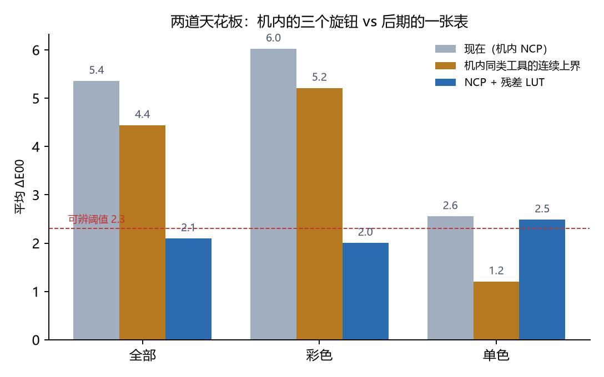

# 20 · 机内到顶了：三格字节全部结案，可达上界 4.43

> 状态（2026-11-02 11:45）：`_probe_kind8` 闪退，第三次同一崩溃签名。
> 至此「NCP 里还有没有没试过的字节自由度」这个问题有了答案：**没有了**。
> 三格（底子编号、饱和度字节、命名空间字节）全部实测关闭。
>
> 顺带把 `oracle_global.py` 加了可达区间参数重跑一遍：把饱和度钳到实测的
> **k ∈ [0.648, 1.275]**、色相钳到 **±11.5°**（±3 档），26 支平均 ΔE00 上界
> 是 **4.43** —— 与「不限档」的 4.44 只差 0.01。逐支最大差 0.15。
>
> **也就是说，就算把 ±3 的钳子拆掉，也几乎一分钱都不多。** 剩下的 4 级差距
> 不是「范围不够」，是「这三个旋钮的正交方向里根本没有那一维」。



---

## 一、三格字节，逐个结案

| 格 | 位置 | 我们试了什么 | 结果 | 收益 |
|---|---|---|---|---|
| 底子编号 | 记录 1 第 24–25 字节 | 换 VIVID / NEUTRAL / LANDSCAPE / PORTRAIT / MONOCHROME 等 | **全部独立生效**，但方向不对 | ΔE00 最好 −0.04 |
| 饱和度 | `<CustomData>` 第 43 字节 | −6 / −9 / +6（越过菜单的 ±3） | **硬钳在 ±3**：−6、−9 与 −3 **逐像素相同**；+6 实测 +36%/+78%，与「截到 +3」预测（+40%/+75%）吻合 | 0 |
| 命名空间 | `<CustomData>` 第 38 字节 | 写 0x08（其余 592 份全是 0x00/0x02） | **打开即崩**，`Rome2.dll +0x13d8f2`，第三次同一签名 | 0 |

### 1.1 底子：能换，但没得换

`_probe_profile` 七张（恒等曲线，所以差别只来自底子）：

| 底子 | 名字 | ΔE00 | ΔC\* | C\* 比 |
|---|---|---|---|---|
| 0x0001 | STANDARD | 0.00 | +0.00 | 1.000 |
| 0x0486 | PORTRAIT | 1.58 | −0.12 | 0.990 |
| 0x04C7 | LANDSCAPE | 2.03 | **+1.12** | **1.092** |
| 0x0014 | D2XMODE I | 1.77 | −1.50 | 0.877 |
| 0x03D5 | D2XMODE II | 1.76 | −1.91 | 0.843 |
| 0x00D6 | D2XMODE III | 1.84 | −0.76 | 0.937 |

五个都独立生效（两两最像的也差 2.58–3.51），可用的只有 kind=1 那 9 个。
但我们的系统性毛病是**偏淡 6.45 级**，而这 9 个里唯一往「更艳」推的只有
LANDSCAPE（+9.2%），其余全在减彩度。对照 VIVID 的 +13~16% 也只换来
ΔE00 −0.04 —— **这一格不是瓶颈**。

### 1.2 饱和度：菜单的 ±3 就是字节的天花板

探针直接改第 43 字节，其余（含 578 B 曲线）逐字节不动：

| 探针 | 写入 | 实测彩度 | 结论 |
|---|---|---|---|
| P1 | −6 | 与 −3 **逐像素相同** | 钳位在 −3 |
| P2 | −9 | 与 −3 **逐像素相同** | 同上 |
| P3 | +6 | +36% | 与「截到 +3」的 +40% 吻合 |
| P4 | +6 | +78% | 与「截到 +3」的 +75% 吻合 |

格式上这个字节能到 ±126，但加载器把它钳进 ±3 档。而 4 支偏浓的
（DRAMA / SILENCE / BLEACH / DENIM）最优 k 恰好落在下界 0.648 ——
**它们要的力度，字节层面就不存在。**

### 1.3 命名空间：NCP 不承载 kind=8

第三次崩溃后把调用链走完了（详见 `21-namespace-byte.md` 第八节）：

```asm
0013A75B  mov  edx, [rbx+0x1b0]   ; kind ← profile 结构字段，不是文件字节
0013A763  call 0x13a170           ; key = (kind<<16)|base，线性扫 38 项
0013A1D4  mov  eax, ecx           ; 查不到 → 返回条目计数 38（不是 −1）
```

写第 38 字节改变不了 `[profile+0x1b0]`，所以 key 依旧是 `0x00010801`。
旁证：593 份现成 NCP 的版本字段**清一色 "0100"**，第 38 字节只有 0x00/0x02，
**世界上没有一份 0x08**。结论：创意底子 `0x0801–0x0814` 只活在 NP3 的原生指针里。

---

## 二、可达上界：4.43（跟理想上界几乎一样）

`oracle_global.py` 原先给的是**理想化上界**：曲线任意、饱和度与色相连续不限档。
现在知道滑块被钳死，把区间换成本机实测值重跑：

```bash
python tools/oracle_global.py --kmin 0.648 --kmax 1.275 --dmax 11.5 \
       --csv oracle_reachable.csv
```

| 组 | 支数 | 现在 | 理想上界 | **可达上界** | 差 |
|---|---|---|---|---|---|
| 全部 | 26 | 5.36 | 4.44 | **4.43** | −0.01 |
| 彩色 | 21 | 6.02 | 5.21 | **5.20** | −0.01 |
| 单色 | 5 | 2.55 | 1.21 | **1.21** | 0.00 |

逐支最大差只有 **0.15**（PINK 7.17 vs 7.32，可达反而更好是因为搜索网格更细），
平均 −0.008。**「拆掉 ±3 的钳子」这件事，值 0.01 个 ΔE00。**

数据：`samples/oracle_reachable.csv`。

### 2.1 为什么差这么小

因为最优解本来就很少贴边：

- k 贴下界 0.648 的只有 6 支（DRAMA / SILENCE / BLEACH / DENIM / BLUE / PINK），
  贴 1.275 上界的 4 支都是**本来就过阈值的**（CHARCOAL / GRAPHITE / CARBON / FLAT），
  它们贴不贴边都无所谓；
- θ 贴 ±11.5° 的有 7 支，但色相旋转对 ΔE00 的边际很小（MORNING 转满 +11.5°
  只从 11.94 降到 10.85）。

### 2.2 所以瓶颈到底是什么

不是「旋钮转不到」，是「旋钮的轴不对」。一条亮度曲线只能沿**亮度**搬像素，
一个倍率只能沿**彩度**整体缩放，一个转角只能把**整个色相环**一起转 ——
而官方底子做的是**逐色相、逐亮度重排**，是个三维映射。一维 + 两个标量
是这个映射的一个极小的子集，**怎么调都填不满**（`18-residual-lut.md` 第二节）。

---

## 三、还真能动的那一格：单色 5 支的曲线

可达上界里唯一「够得着却没拿到」的东西：

| 滤镜 | 现在 | 可达上界 | 差距来源 |
|---|---|---|---|
| BINARY | 7.75 | **1.67** | \|ΔL\*\| 9.77 —— 纯影调错，曲线能全吃 |
| CHARCOAL | 1.08 | 0.89 | 已过阈值 |
| GRAPHITE | 1.56 | 1.26 | 已过阈值 |
| CARBON | 1.19 | 1.10 | 已过阈值 |
| MONOCHROME | 1.19 | 1.12 | 已过阈值 |

**这 5 支不需要任何字节游戏**：灰度画面只有一维信息，一条 257 点曲线本该够用。
它们现在对不上，是因为曲线是拿另一张底片（DSC_3891）的模型拟合出来的，
不是引擎不行。重拟合即可，预计 2.55 → 1.21，BINARY 一支就吃掉 6 个 ΔE00。

---

## 四、整条路线的最终形态

```
NP3（指针 + 8 个参数）
  │  ✗ 底子搬不过来（NCP 不承载 kind=8）
  │  ✗ 逐色相重排表达不了（一维 + 两标量）
  │  ✗ 清晰度/快速锐化格式里没有
  ▼
NCP  v3       ΔE00 5.36   ← 现在的发布版
  │  ＋曲线重拟合（只对单色 5 支有效）
  ▼
NCP  v4       单色 ~1.2 / 彩色仍是 6.0（可达上界 5.20）
  │  ＋per-支 33³ 残差表（后期）
  ▼
最终成片      ΔE00 2.10（留出 2.13），20/26 支 < 2.0
```

一句话：**机内管到 4.4~5.2，剩下那 2 级只能交给后期，且必须每支一张表。**

---

## 五、复现

```bash
# 1) 第三次崩溃的事实（偏移必须是 0x13d8f2）
powershell -c "Get-WinEvent -FilterHashtable @{LogName='Application';StartTime=(Get-Date).AddHours(-1)} | ? {\$_.Message -match 'Rome2'} | select -First 1"

# 2) 可达上界（约 13 分钟）
python tools/oracle_global.py --kmin 0.648 --kmax 1.275 --dmax 11.5 --csv oracle_reachable.csv

# 3) 逐支对比
python - <<'PY'
import csv
n={r['name']:r for r in csv.DictReader(open('samples/oracle_reachable.csv',encoding='utf-8-sig'))}
o={r['name']:r for r in csv.DictReader(open('samples/oracle_global.csv',encoding='utf-8-sig'))}
for k in n:
    print('%-14s 理想 %.2f  可达 %.2f' % (k, float(o[k]['dE00_oracle']), float(n[k]['dE00_oracle'])))
PY
```

---

## 六、已删除的会闪退的包

| 目录 | 大小 | 原因 |
|---|---|---|
| `_probe_batch` | 88 MB | 含 0x0813 |
| `_probe_batch_fix` | 77 MB | 去掉 B8 仍崩 |
| `_probe_kind8` | 33 MB | 第 38 字节 0x08 |
| `_probe_kind8_b` | 11 MB | 同上（对照张） |
| `_probe_baseid` | — | 含 B5–B8 四个 08xx |
| `_probe_batch_fix_src` | — | 同一批 NCP 源 |

`pack_kind_probe.py` 已加硬闸门：不加 `--i-know-it-crashes` 直接抛异常。
`pack_baseid_probe.py` 的 08xx 分支同样要 `--allow-creative` 才会写。
剩下 7 个包（`_probe_base` / `bisect` / `flag` / `name` / `profile` / `range` / `slider`）
已扫描确认**不含任何 08xx 底子**。
