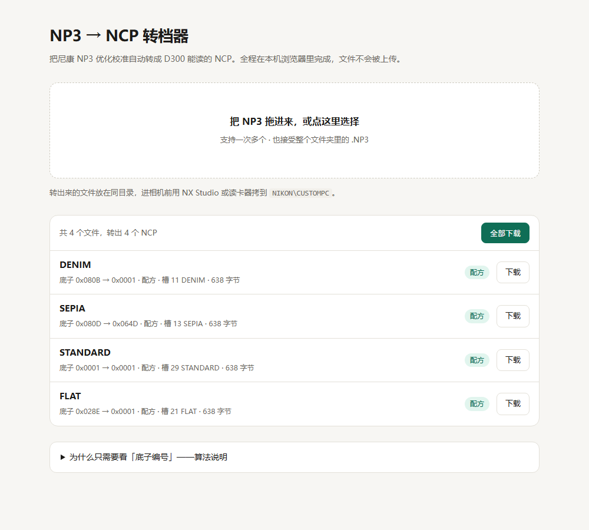

# 21 · NP3 → NCP：一个能跑通的通用算法，和一个网页

> 状态（2026-11-02 11:55）：**能，而且不需要拟合新东西。**
> 但先要把一个前提纠正过来 —— **NP3 里没有曲线**。
> 算法的实质不是「按曲线匹配」，而是「按底子编号查配方」。
> 工具 `tools/np3_to_ncp.py`，网页 `web/np3-to-ncp/index.html`（纯客户端，38 KB）。



---

## 一、先纠正前提：NP3 里没有曲线

拆一份 NP3（`_filters_np3/PICCON01.NP3`，248 字节）：

```
NCP\0
卡 1   版本      "0300"      ← 注意不是 NCP 的 "0100"
卡 2   名字      "DREAM"
卡 3   底子      0x0801      ← 唯一的颜色来源
卡 4–5, 15–20   其他（多为 FF = 不适用）
卡 6   锐化      7E 04
卡 7   清晰度    7C 04
卡 8   对比度    80 04  →  0
卡 9   亮度      FF 04  →  不适用
卡 10  饱和度    80 04  →  0
卡 11  色相      80 04  →  0
卡 12–14  滤镜/调色/调色强度
卡 21  效果级别  8A 0A  →  6.25
卡 22  快速锐化  7C 04
```

22 张卡，每张 2 字节，**没有一条曲线**。

把仓库里 59 份 NP3 全扫一遍，字段分布是这样的：

| 字段 | 非零份数 | 取值 | NCP 有没有位置 |
|---|---|---|---|
| 对比度 | **0** / 59 | — | 有（但被钉成「曲线负责」） |
| 亮度 | **0** / 59 | — | 同上 |
| 饱和度 | **0** / 59 | — | 有（±3 档） |
| 色相 | **0** / 59 | — | 有（±3 档） |
| 底子编号 | 59 / 59 | 0x0001–0x081F | 只有 9 个合法 |
| 锐化 | 57 / 59 | −0.5 / +1 / +2 / +3 / +4 | 有 |
| 清晰度 | 53 / 59 | −1 / +0.5 / +1 | **没有** |
| 快速锐化 | 53 / 59 | −1 / +1 / +2 | **没有** |
| 效果级别 | 42 / 59 | 3.125 / 6.25 | **没有** |

三个结论，逐个都很硬：

1. **四个「调色滑块」永远是 0** —— 和 `09-np3-fidelity.md` 的字段表完全吻合。滤镜的个性不在参数里。
2. **会变的只有底子和锐化**，而清晰度/快速锐化/效果级别 NCP 根本装不下。
3. 所以「NP3 → NCP」在信息上退化成一句话：**结果只取决于底子编号。**

这也解释了为什么以前那些按曲线拟合的做法看起来在「猜」：那条曲线不是从 NP3 读出来的，
是我们**为了让基础底子模仿创意底子而造出来的补偿**。NP3 那边从来没有曲线可以搬。

---

## 二、算法：一张「底子 → 配方」表

配方 = `(输出底子, 8 个滑块, 257 点曲线)`。26 支滤镜的配方已经用真渲染拟合好了
（`ncp/release`，ΔE00 5.36），而且这 26 支**恰好覆盖 0x0801–0x0814 全部 20 个创意底子**
外加 6 个基础底子。

```
读 NP3 → 底子 b
    ├─ b 在配方表里（26 个）        → 用那张配方          【配方】逐字节等于发布版
    ├─ b 是 NCP 认可的 9 个之一      → 恒等曲线 + 该底子    【直搬】几乎无损
    └─ 都没有（0x02CF / 0x081F）     → 借编号最近的配方    【估计】会有偏差
```

覆盖率（扫全部 59 份现成 NP3）：

| 模式 | 份数 | 底子 |
|---|---|---|
| 配方 | 54 | 0001 00C3 028E 03C2 04C7 064D + 0801–0814 |
| 直搬 | 2 | 0486 PORTRAIT |
| 估计 | 3 | 02CF AUTO、081F |

**创意底子 20/20 全部命中**，市面上见得到的 NP3 基本都落在前两行。

### 2.1 为什么「直搬」几乎无损

NCP 那 9 个合法底子在引擎里就是同一张表，把 NP3 的对比度/亮度/饱和度/色相直接翻成
NCP 的滑块字节（对比度亮度写 `0x01` = 曲线负责，饱和色相 `0x80+n`，钳到 ±3），
剩下的交给引擎自己的底子。丢的只有清晰度和快速锐化。

### 2.2 为什么「配方」是唯一出路

创意底子 `0x0801–0x0814` 只登记在引擎的 kind=8 命名空间，而 **NCP 这个容器表达不了 kind=8**
（写进去 NX Studio 在 `Rome2.dll +0x13d8f2` 崩，实测三次，见 `19`/`20`）。
所以只能「换成基础底子 + 一条曲线去逼近」，这正是配方在做的事 —— 也是为什么
这条路的终点仍是 ΔE00 5.36，剩下的靠 `lut/` 那张后期表补到 2.10。

---

## 三、自检：两处逐字节比对

```bash
python tools/np3_to_ncp.py --verify
# 26 / 26 「完全一致」—— 配方模式转出来的文件与发布版逐字节相同
```

网页那条路单独验：把 `index.html` 里的脚本推进 Node 的 V8 里跑，
26 支输出与发布版 `cmp` 全部相等（连名字都一致），随后又用 Edge 无头截图确认 UI。

`--stats` 是覆盖率自检，`--verify` 是回环比对，两个都不需要相机。

---

## 四、网页

`web/np3-to-ncp/index.html`，单文件 38 KB，**没有任何网络请求**：

- 拖进一个或一堆 `.NP3` → 立刻列出「名字 / 底子 A → B / 模式 / 字节数」，逐个或全部下载
- 配方 JSON 直接内嵌（26 条 base64 模板 + 1 张恒等模板），断网可用
- 解析、选配方、改名字、写字节全在浏览器里，文件不出本机
- 生成的文件是标准 638 字节 NCP，拷到 `NIKON\CUSTOMPC`

模板与数据分离：`template.html` 是源，`np3_to_ncp.py --build-web` 把配方注进去生成
`index.html`。改文案改 `template.html`，改配方重新 build。

```bash
# 改完配方（重跑 lut_fit / 换 release）后重新生成网页
python tools/np3_to_ncp.py --build-web
```

---

## 五、局限（这几条必须一起说）

1. **不突破 NCP 的表达上限**。网页只是把已有的 26 条配方套到任意 NP3 上，
   不会比 `ncp/release` 更准 —— 因为配方就是它。
2. **同底子的两份 NP3 转出来几乎一样**。既然 NP3 里只有底子和锐化，
   Nikon 的 DREAM 和你从网上下载的「DREAM 改」如果底子都是 0x0801，转档结果就是同一张 NCP。
   这不是算法偷懒，是源文件里真的没有别的信息。
3. **配方模式沿用配方的锐化**，不搬 NP3 的锐化值。D300 的锐化刻度和新机身不是一套标尺，
   硬搬反而更差；那 26 条配方里的锐化字节是按 D300 出图调过的。
4. **估计模式是猜**。`02CF AUTO`、`081F` 这类没有配方的底子，只能借邻居，
   画面偏差预计 2–4 个 ΔE00，不要在正式出图里当准。
5. **只对 D300 有效**。底子编号与命名空间的结论都来自 D300 + NX Studio 1.7.1，
   换机身要重测。

---

## 六、复现

```bash
cd d300
python tools/np3_to_ncp.py --stats                # 59 份 NP3 的覆盖率
python tools/np3_to_ncp.py --verify               # 26 支回环，应全「完全一致」
python tools/np3_to_ncp.py -i a.NP3 -o a.NCP      # 单个
python tools/np3_to_ncp.py --dir in/ --outdir out # 批量
python tools/np3_to_ncp.py --build-web            # 重新生成网页
```
